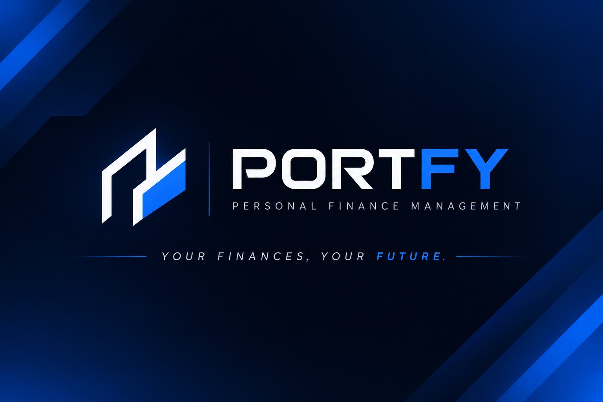

<!-- ================================================= -->
<!-- LUCAS AQUINO | GITHUB PROFILE -->
<!-- ================================================= -->

  

<!-- CONTACT -->

  
  
  

  

---

## About Me

Olá! Sou estudante de Ciência da Computação, interessado em Engenharia de Software, desenvolvimento de aplicações e Inteligência Artificial.

Busco transformar conhecimentos acadêmicos em soluções práticas, desenvolvendo projetos e aprimorando constantemente minhas habilidades técnicas.

- Estudante de Ciência da Computação.
- Atualmente trabalhando com C#, React e SQL.
- Aprofundando conhecimentos em Java, Python e JavaScript.
- Desenvolvendo projetos pessoais e acadêmicos.
- Interessado em Engenharia de Software e Inteligência Artificial.
- Em busca de oportunidades para iniciar minha carreira na área de tecnologia.

---

## Technologies & Skills

### Currently Using

  
  

### Currently Learning

  

### Deepening Knowledge

  
  

---

## GitHub Status

  

  Automatically updated GitHub statistics.

---

---

## Featured Project

  

  <strong>PERSONAL FINANCE MANAGEMENT</strong>

  Uma aplicação de gestão financeira desenvolvida em equipe, com foco em organização financeira, controle de orçamento, acompanhamento de despesas e simulação de investimentos.

### Technologies

  
  

### Project Overview

- Controle de despesas e orçamento pessoal.
- Gerenciamento de informações financeiras.
- Simulação de aportes e investimentos.
- Visualização e acompanhamento financeiro.

  

---

  <strong>Always learning. Always building.</strong>

  Building knowledge through code, projects and continuous learning.

